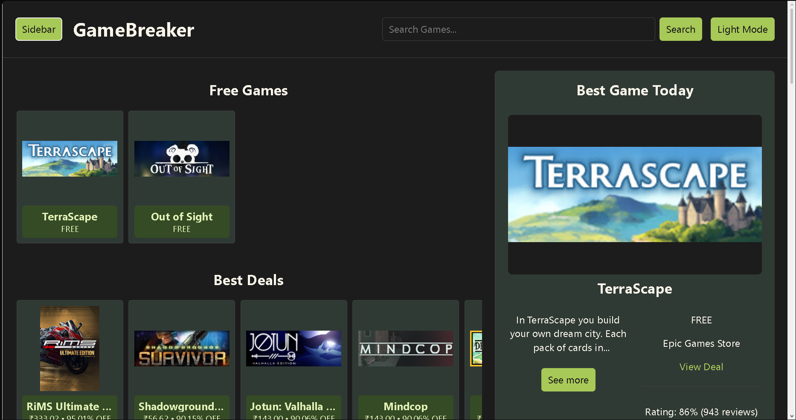
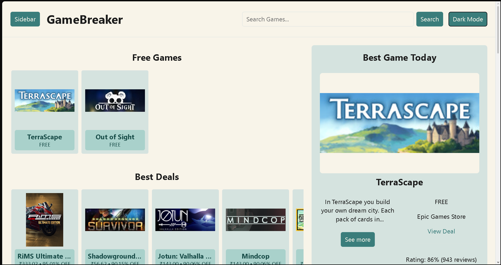
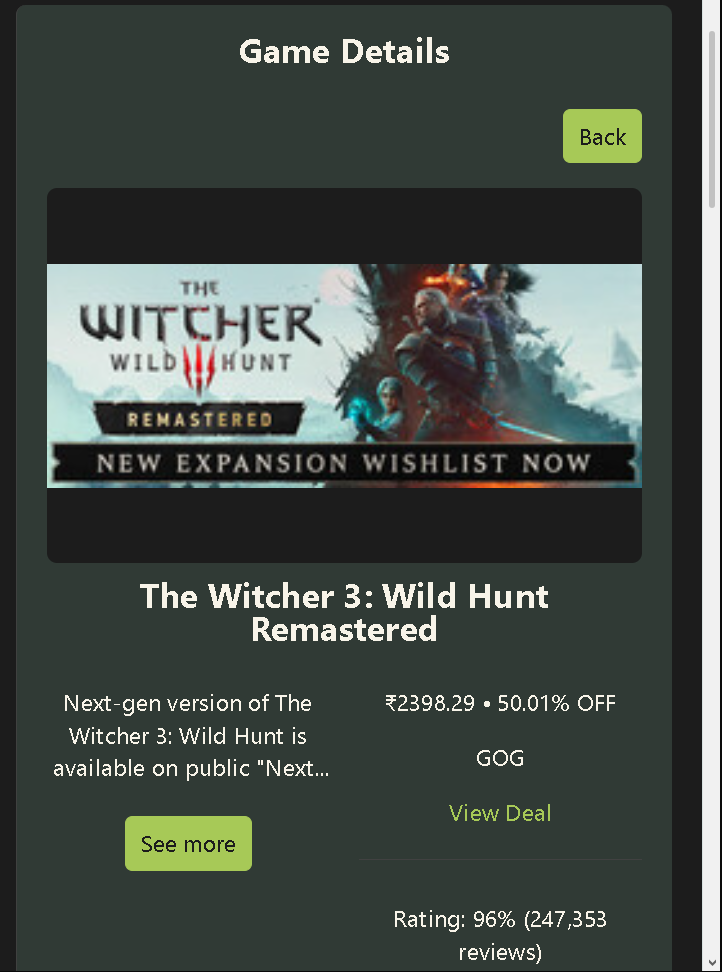
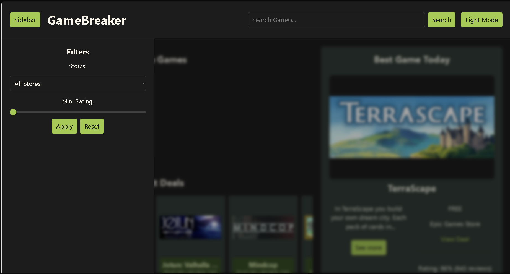

# GameBreaker

## Break the best deals in time. Across stores all in one place


 

GameBreaker brings limited-time free games and discounted deals from
supported stores together in one place. Browse current offers, compare
prices, explore game details, and discover deals worth claiming or
buying.

**[▶ Live Demo](https://gamebreaker-psi.vercel.app)**

## Screenshots

<table>
    <tr>
        <td width="50%">
            
        </td>
        <td width="50%">
            
        </td>
    </tr>
    <tr>
        <td width="50%">
            
        </td>
        <td width="50%">
            
        </td>
    </tr>
</table>

## What You Can Do

- **Find free games:** Browse games that currently have a free offer.
- **Browse best deals:** See discounted games, with historical-low
    prices prioritized.
- **Switch views:** Flip the main grid between Free Games and Best
    Deals.
- **Check Best Game Today:** See a featured pick based on the games
    and offer data currently available.
- **Search and filter:** Search loaded games by title, filter by store
    or minimum Steam rating, and apply or reset filters.
- **Explore game details:** Check the current cheapest offer, Steam
    rating and review count, historical-low pricing, and available
    descriptions, developers, and genres.
- **Compare stores:** See other available offers for a game and follow
    a deal to the retailer.
- **View prices in INR:** Convert USD prices using the latest exchange
    rate available from Frankfurter.
- **Choose your theme:** Switch between dark and light mode.

## How It Works

CheapShark supplies the deal and pricing data. GameBreaker normalizes
those responses and groups offers for the same game, so prices from
different stores can be compared in one place.

RAWG provides extra game details, such as descriptions, developers, and
genres. Since RAWG requires an API key, those requests go through a
small Python serverless function on Vercel. The key stays in server-side
environment variables instead of being exposed in the browser.

Frankfurter supplies the exchange rate used for USD-to-INR price
conversion. Filtering, sorting, searching, and choosing the featured
game happen in the React frontend.

## Tech Stack

 | Technology | Used for |
| --- | --- |
|  | Frontend UI |
|  | Type-safe application logic |
|  | Development and production builds |
|  | Styling and themes |
| [](https://www.cheapshark.com/) | Deals, store offers, ratings, and pricing |
| [](https://rawg.io/) | Game descriptions and metadata |
|  | Serverless RAWG proxy |
| [](https://frankfurter.dev/) | Currency conversion |
|  | Deployment |

## A Few Boundaries

- GameBreaker currently uses the first **60 deal records** returned by
    CheapShark. It doesn't show every deal in CheapShark's catalogue.
- Search only covers games in the data currently loaded by
    GameBreaker; it isn't a universal game search.
- Descriptions and developer details depend on RAWG returning a
    suitable match, so some metadata may be unavailable.
- INR prices are estimates based on the exchange rate returned by
    Frankfurter. The final price at a retailer may differ.
- GameBreaker doesn't have user accounts, a database, or persistent
    personal wishlists.

## Run Locally

You'll need Node.js and npm.

``` bash
git clone <your-repository-url>
cd gamebreaker
npm install
npm run dev
```

Vite will print the local development URL in the terminal.

### Available Scripts

``` bash
npm run dev      # Start the development server
npm run build    # Type-check and build the frontend
npm run lint     # Run ESLint
npm run preview  # Preview the production build
```

### RAWG Configuration

The serverless function lives at `api/rawg.py` and reads the
`RAWG_API_KEY` environment variable. To run your own deployment,
configure this variable in your Vercel project settings.

The current Vite development proxy forwards `/api` requests to the
deployed GameBreaker endpoint. If you fork the project, update
`vite.config.ts` to use your own deployment or configure a local Vercel
development setup.

## Project Structure

``` text
gamebreaker/
├── api/
│   └── rawg.py
├── public/
│   └── icons.svg
├── screenshots/
│   ├── homepage-dark.png
│   ├── homepage-light.png
│   ├── game-details.png
│   └── filters.png
├── src/
│   ├── components/
│   ├── services/
│   ├── types/
│   ├── App.tsx
│   ├── App.css
│   └── main.tsx
├── index.html
├── vite.config.ts
└── package.json
```

## Data Sources

- [CheapShark](https://www.cheapshark.com/) --- game deals and
    pricing.
- [RAWG](https://rawg.io/) --- game metadata.
- [Frankfurter](https://frankfurter.dev/) --- exchange-rate data.
